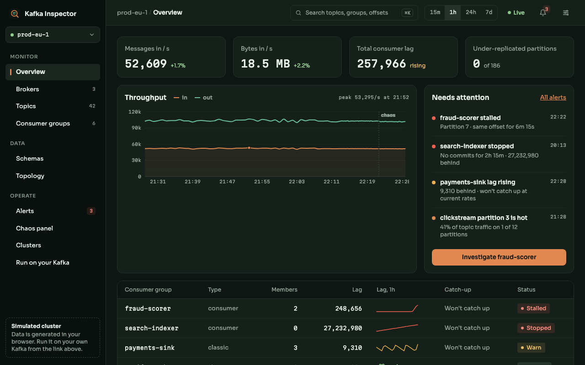
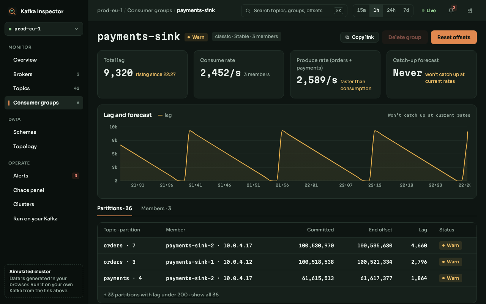
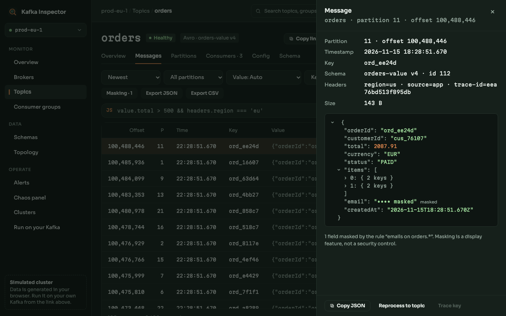
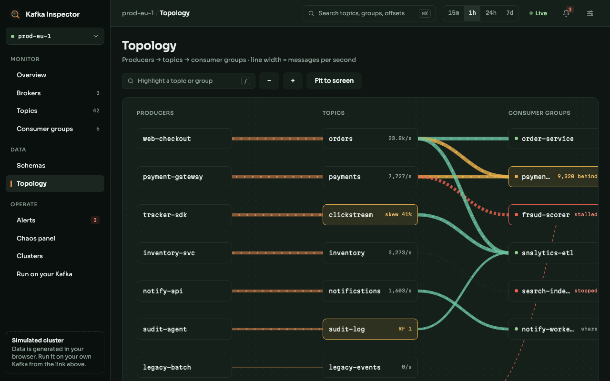
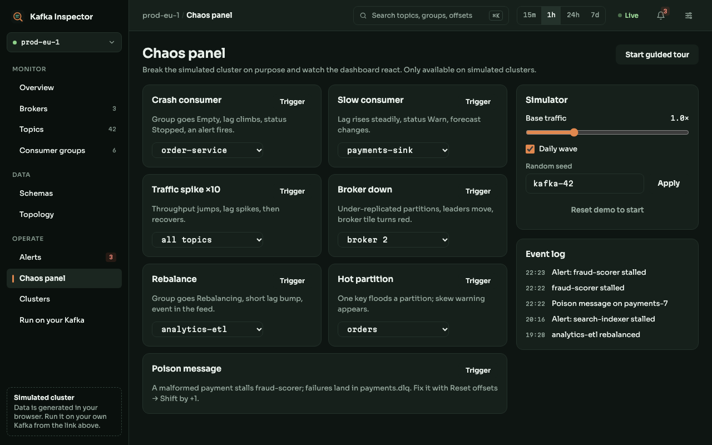
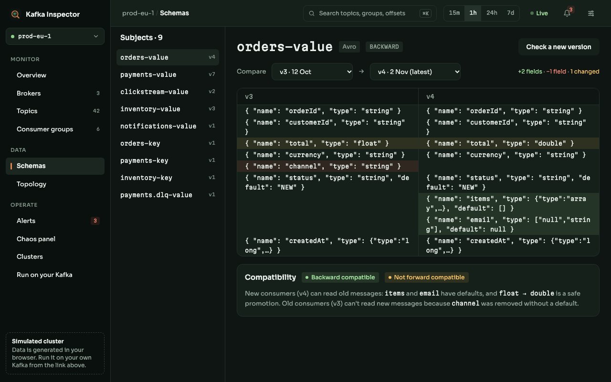
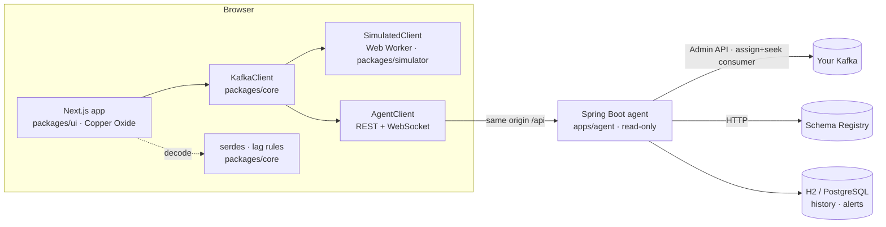

# Kafka Inspector

A real-time UI for Apache Kafka that shows what happened, what is about to happen, and tells you.
Metric history, lag health status, catch-up forecasts, built-in alerts and a live topology map — try it in
the browser on a simulated cluster, or run it read-only on your own Kafka with one Docker image.

- **Live demo:** _deploy pending_ — `pnpm dev` runs the same demo locally (see [Develop](#develop))
- **Self-host:** `docker run` the image against your cluster ([guide](#self-hosting))
- **Licence:** Apache-2.0



## What it does

|                                                                                                                                                                                                                                                                                                        |                                                                                      |
| ------------------------------------------------------------------------------------------------------------------------------------------------------------------------------------------------------------------------------------------------------------------------------------------------------ | ------------------------------------------------------------------------------------ |
| **Is anything falling behind?** Every consumer group gets a status (Healthy, Warn, Stalled, Stopped) from shared, tested lag rules, and a forecast: “catches up in ~14 min” or “won’t catch up at current rates”.                                                                                      |                    |
| **What’s in this topic?** Browse, live tail, JavaScript filters in a sandboxed worker, multi-topic search, decoding of Avro / JSON Schema (Schema Registry), JSON, text, hex and number keys. Undecodable messages show an annotated hex dump instead of disappearing. Masking, export, saved filters. |  |
| **How does data flow?** Producers → topics → consumer groups as a live map: edge width is throughput, colour is health, a stalled consumer turns red.                                                                                                                                                  |                                                |
| **Break it on purpose.** The demo has a chaos panel: crash a consumer, spike traffic ×10, take a broker down, inject a poison message — and a guided tour that walks one incident end to end.                                                                                                          |                                                    |

Also: alerts with rule builder and 24 h preview, schema version diff with per-field compatibility
( ), offset reset with dry run (demo), command palette (⌘K), deep links for
every view, dark and light themes, WCAG 2.1 AA, reduced-motion support.

## Architecture



- **One codebase, two modes.** The hosted demo is a static export: no `/api/info`, so the app starts the
  simulator. The Docker image serves the same files at `/app` and the API at `/api`, so the app talks to the agent.
- **The UI only talks to `KafkaClient`.** Components never import the simulator, `fetch` or WebSocket.
- **Decoding happens in the browser in both modes.** The agent returns raw bytes; the simulator produces real
  Confluent-framed Avro, so the same decoder is exercised everywhere.
- **Same lag logic everywhere.** Lag status and forecast are pure functions in `packages/core`, ported to Java
  in the agent; both run the same 24 test vectors (`packages/core/test/lag-vectors.json`).

## How the simulator works

`packages/simulator` runs in a Web Worker (Comlink) and models a 3-broker KRaft cluster: 42 topics,
186 partitions, 6 consumer groups including a share group (KIP-932).

- **Ticks every second.** Each topic’s produce rate is a base rate × a 24 h sine wave × seeded noise × chaos
  multipliers, spread over partitions (with skew, e.g. `clickstream` partition 3 takes 41%). Consumer groups
  advance their committed offsets at their own capacity, capped at the end offset.
- **24 h of history** is back-filled on load (60 s resolution, 1 s for the last 15 minutes) in ~250 ms.
- **Messages are a pure function** of `(seed, topic, partition, offset)` — nothing is stored. Avro topics carry
  the Confluent wire format (magic byte, schema id, Avro payload) from the simulator’s own Schema Registry.
- **The opening state tells a story:** `fraud-scorer` is stalled on a poison message on `payments` partition 7,
  `payments-sink` builds lag and drains it on a 16-minute cycle, `search-indexer` stopped two hours ago.
  Fix the stall with _Reset offsets → Shift by +1_ and watch it recover.
- **Your changes persist** (created topics, produced messages, offset resets) in IndexedDB and replay on reload.
  _Reset demo_ clears them.
- `?preview=loading|disconnected|readonly` shows the other designed states on the demo.

The demo always shows a “Simulated cluster” note: generated data is never presented as real.

## Self-hosting

```bash
docker run -d --name kafka-inspector -p 8080:8080 \
  -e KAFKA_BOOTSTRAP=broker:9092 \
  -e KI_ADMIN_PASSWORD=change-me \
  -v ki-data:/data \
  ghcr.io/paramvsi/kafka-inspector:1.0.0
```

Open http://localhost:8080 and sign in as `admin` with `KI_ADMIN_PASSWORD`. The demo’s
**Run on your own Kafka** page generates a `docker-compose.yml`, a `.env` with variable _names_ (never values)
and a `docker run` line, entirely in your browser.

> The image is not published yet: the release workflow is ready, and the first image ships once the product
> name is settled. Until then build it: `docker build -f deploy/Dockerfile -t ghcr.io/paramvsi/kafka-inspector:1.0.0 .`

| Variable                                                             | Default                 | Meaning                                                                           |
| -------------------------------------------------------------------- | ----------------------- | --------------------------------------------------------------------------------- |
| `KI_ADMIN_PASSWORD`                                                  | required                | Sign-in password; the agent refuses to start without it                           |
| `KAFKA_BOOTSTRAP`                                                    | —                       | Shortcut for one cluster named `default`                                          |
| `KI_CLUSTERS_0_NAME` / `_BOOTSTRAP` / `_SECURITY`                    | — / — / `PLAINTEXT`     | Cluster name, bootstrap servers, `PLAINTEXT`, `SSL`, `SASL_PLAINTEXT`, `SASL_SSL` |
| `KI_CLUSTERS_0_SASL_MECHANISM` / `_SASL_USERNAME` / `_SASL_PASSWORD` | —                       | `PLAIN`, `SCRAM-SHA-256`, `SCRAM-SHA-512`                                         |
| `KI_CLUSTERS_0_SSL_TRUSTSTORE_LOCATION` / `_PASSWORD`                | —                       | Custom CA                                                                         |
| `KI_CLUSTERS_0_SCHEMA_REGISTRY` / `_USERNAME` / `_PASSWORD`          | —                       | Schema Registry URL and basic auth                                                |
| `KI_DB_URL`                                                          | `jdbc:h2:file:/data/ki` | History and alerts; a PostgreSQL JDBC URL also works                              |
| `KI_SAMPLE_INTERVAL`                                                 | `10s`                   | How often the agent samples the cluster                                           |
| `KI_PORT`                                                            | `8080`                  | HTTP port                                                                         |

Use `KI_CLUSTERS_1_…` for more clusters. The same keys work in `/config/kafka-inspector.yml`.

**Providers** (settings below are not verified against the live services):

- **Amazon MSK:** `SASL_SSL` + `SCRAM-SHA-512`, port 9096. IAM auth is not supported in this version.
- **Confluent Cloud:** `SASL_SSL` + `PLAIN`; API key as username, secret as password. Registry basic auth with a registry API key.
- **Aiven:** `SASL_SSL` + `SCRAM-SHA-256`; add the project CA via `KI_CLUSTERS_0_SSL_TRUSTSTORE_LOCATION` if required.

**Security.** Version 1 is read-only: the agent has no endpoint that creates, deletes, produces, resets or
edits anything, and its browse consumer has no `group.id` and never commits. Sessions use an HttpOnly,
SameSite=Strict cookie with CSRF double-submit; sign-in is rate-limited; secrets are never logged. The image
runs as a non-root user with a read-only root filesystem (only `/data` is writable). Masking rules are a
display feature, not a security control.

## Develop

```bash
pnpm install
pnpm dev                 # http://localhost:3000/app — simulated cluster
pnpm test                # unit tests (core, simulator, ui, web)
pnpm build && pnpm e2e   # Playwright against the static export (chromium + reduced motion)
cd apps/agent && ./gradlew test        # agent + Testcontainers (Kafka 4.1)
docker compose -f deploy/docker-compose.dev.yml up --build   # agent + Kafka + Schema Registry + traffic
```

Repository: `apps/web` (Next.js static export), `apps/agent` (Spring Boot 4.1, Java 21),
`packages/core` (types, `KafkaClient`, lag rules, serdes), `packages/simulator`, `packages/ui`
(Copper Oxide components). Specs and decisions live in [`docs/`](docs/).

## Trademark

Apache Kafka and Kafka are trademarks of the Apache Software Foundation. Kafka Inspector is not affiliated
with or endorsed by the ASF.

## Licence

Apache License 2.0 — see [LICENSE](LICENSE).
